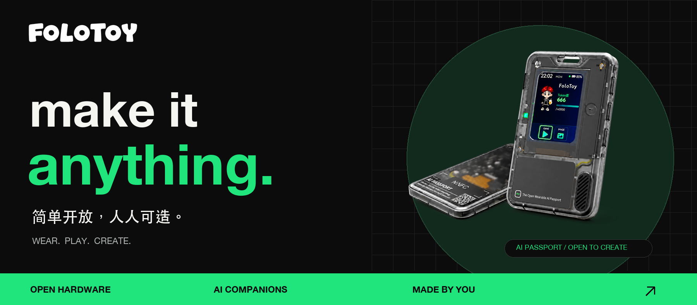
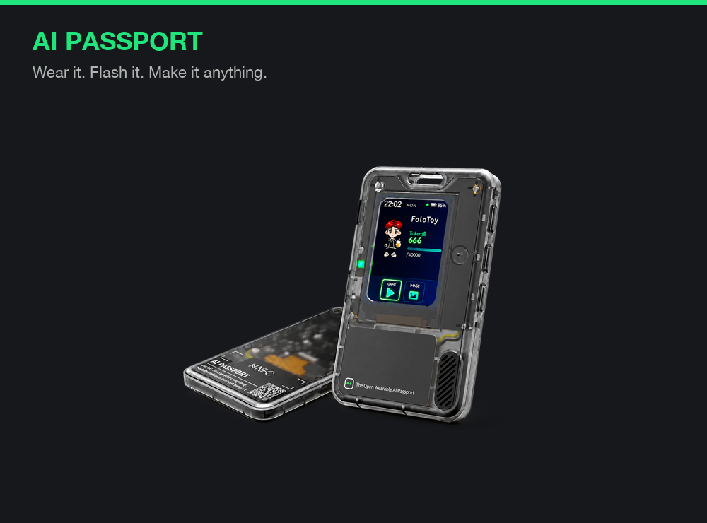
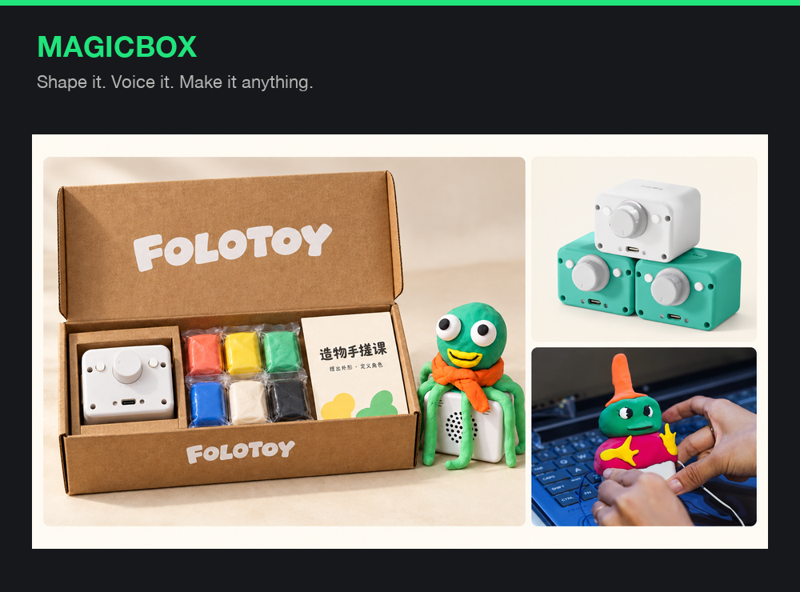

  

  <b><a href="https://ai-passport.folotoy.cn">AI Passport 官网</a></b> &nbsp;·&nbsp;
  <b><a href="https://github.com/FoloToy/ai-passport">开始开发 · Start building</a></b> &nbsp;·&nbsp;
  <b><a href="https://docs.folotoy.com">文档 · Docs</a></b> &nbsp;·&nbsp;
  <b><a href="https://folotoy.com">FoloToy</a></b>

**make it anything.** FoloToy brings AI into things you can hold, wear, and make your own. From AI Passport to MagicBox, explore hardware, firmware, and developer resources to turn an idea into a companion, a tool, a game—or something entirely yours.

**简单开放，人人可造。** FoloToy 让 AI 变成可以触摸、佩戴和亲手创造的伙伴。 从 AI Passport 到 MagicBox，我们提供硬件、固件与开发资源，让你把一个想法做成随身伙伴、实用工具、小游戏，或属于自己的全新体验。

## Find your canvas · 从这里开造

<table>
<tr>
<td width="50%" valign="top">

<h3>AI Passport · AI 通行证</h3>

A wearable AI platform for your ideas. Explore firmware, hardware guides, and community applications.

戴在身上，把玩法握在自己手里。探索固件、硬件指南与社区应用，创造你的下一种可能。

<a href="https://ai-passport.folotoy.cn"><b>探索产品 ↗</b></a> &nbsp;·&nbsp; <a href="https://github.com/FoloToy/ai-passport"><b>开发资源 ↗</b></a>

</td>
<td width="50%" valign="top">

<h3>MagicBox · 魔法盒子</h3>

Give your creation a voice. Explore MagicBox hardware BSPs and build a character of your own.

捏一个外形，赋予它声音。从硬件开发资源出发，让亲手创造的角色成为 AI 伙伴。

<a href="https://github.com/FoloToy/MagicBox"><b>开发资源 ↗</b></a> &nbsp;·&nbsp; <a href="https://github.com/FoloToy/magicbox-arduino"><b>Arduino 资源 ↗</b></a>

</td>
</tr>
</table>

## Pick a starting point · 找到你的入口

| 想做什么 · I want to… | 从这里开始 · Start here |
| :--- | :--- |
| **体验 AI Passport** · Try AI Passport | [官网与玩法 · Website](https://ai-passport.folotoy.cn) |
| **用 AI 开发新玩法** · Build with an AI coding agent | [AI Passport 开发指南 · Agent instructions](https://github.com/FoloToy/ai-passport/blob/main/AGENTS.md) · [社区应用参考 · Examples](https://github.com/FoloToy/ai-passport/tree/main/docs/reference) |
| **选择熟悉的开发方式** · Choose a development stack | [ESP-IDF](https://github.com/FoloToy/ai-passport) · [Arduino](https://github.com/FoloToy/ai-passport-arduino) · [MicroPython](https://github.com/FoloToy/ai-passport-micropython) |
| **开发 MagicBox 硬件** · Build on MagicBox | [BSP 与硬件版本说明 · Hardware profiles](https://github.com/FoloToy/MagicBox) |
| **部署 FoloToy 社区服务** · Self-host the community server | [部署配置 · Self-hosting](https://github.com/FoloToy/folotoy-server-self-hosting) · [文档 · Docs](https://docs.folotoy.com) |

## Create & share · 一起把想法做出来

Found a bug, built a new play, or have an idea? Open an issue or a pull request in the relevant repository. For AI Passport contributions, start with the [contribution guide](https://github.com/FoloToy/ai-passport/blob/main/.github/CONTRIBUTING.md).

发现问题、做出新玩法，或有一个想试试的点子？欢迎到对应仓库提交 Issue 或 Pull Request。参与 AI Passport 共创，可以先阅读[贡献指南](https://github.com/FoloToy/ai-passport/blob/main/.github/CONTRIBUTING.zh_CN.md)。

<b>make it anything.</b> 简单开放，人人可造。

